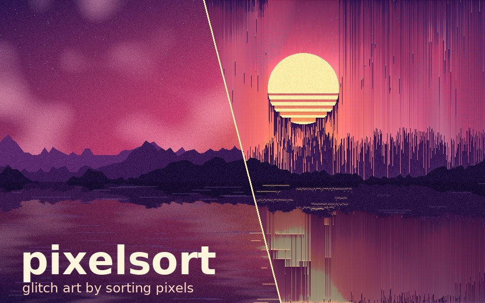
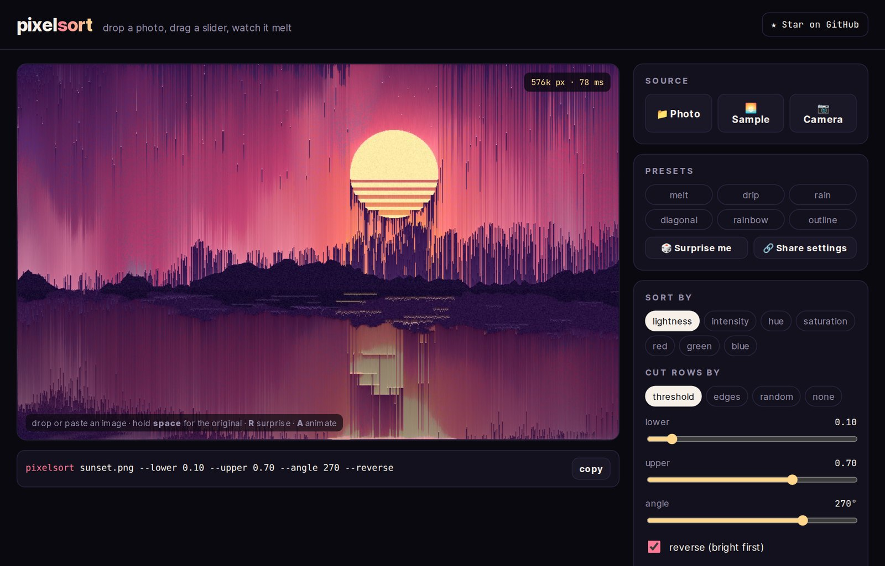
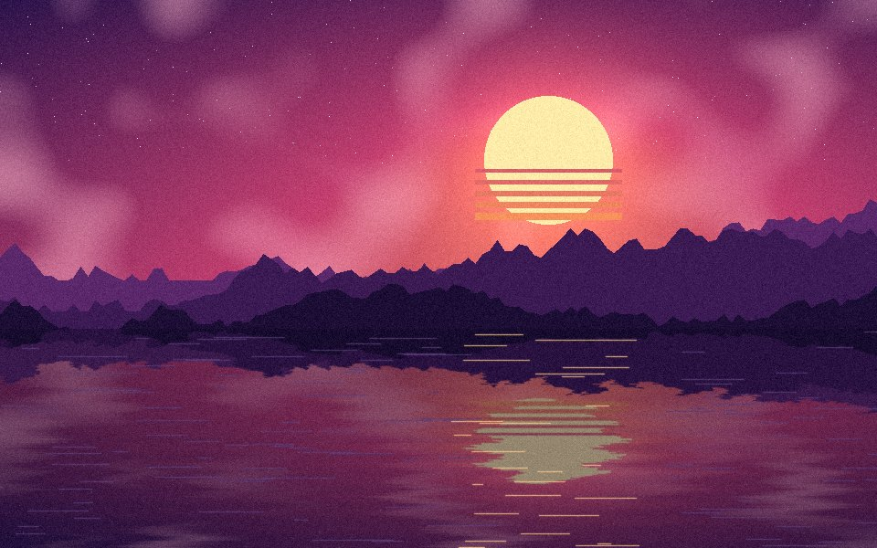
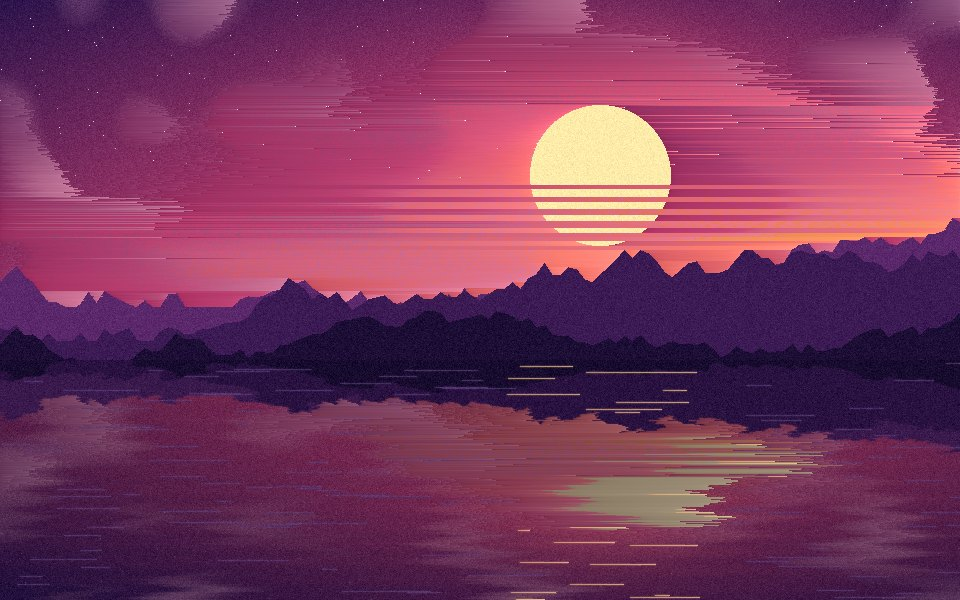
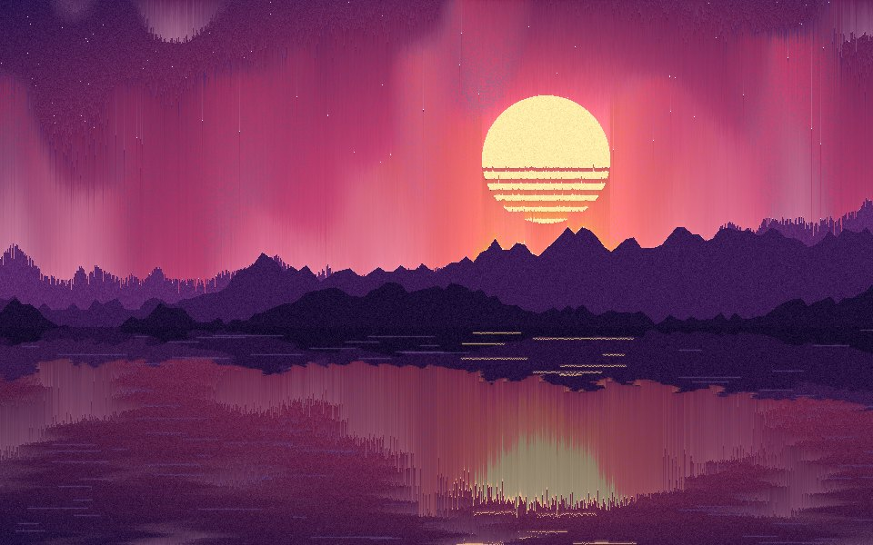
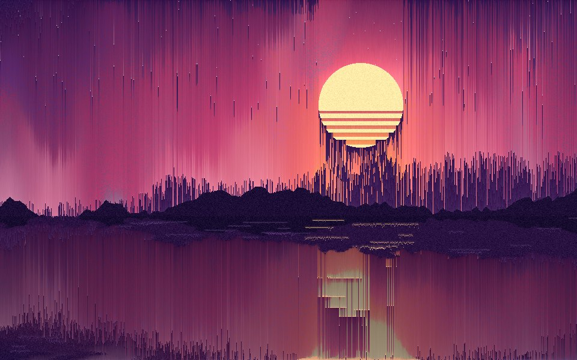
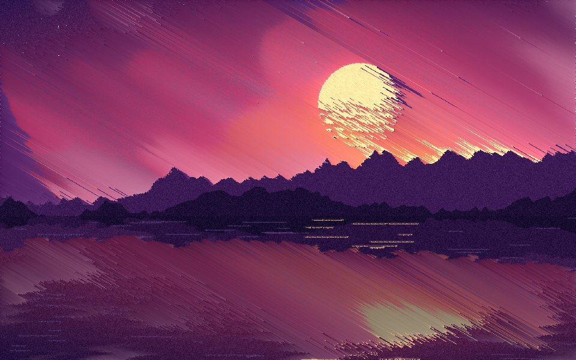
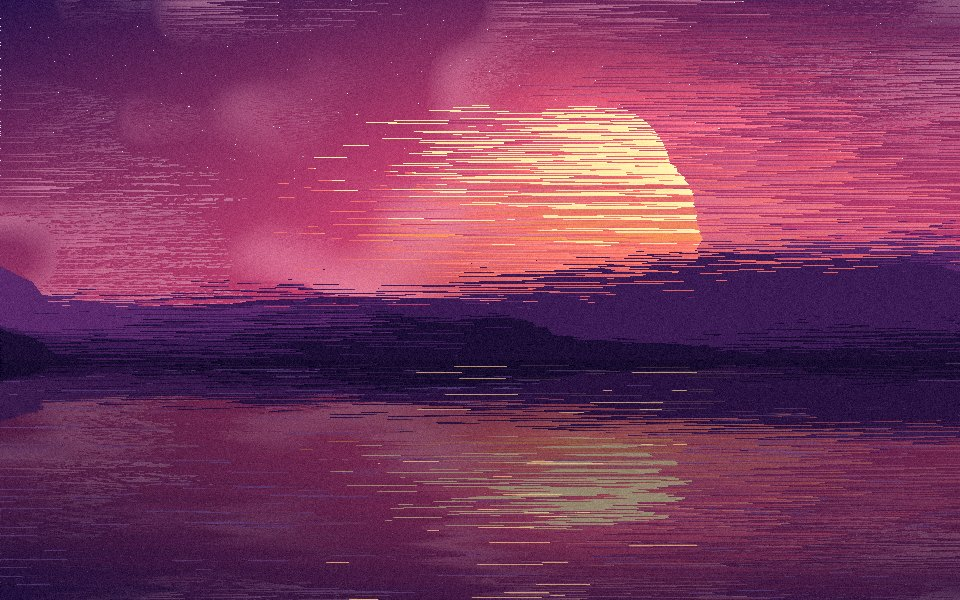
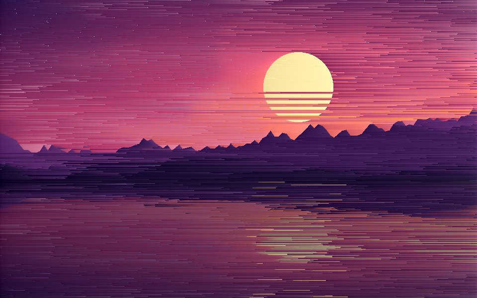

<div align="center">



# pixelsort

**Glitch art by sorting pixels.** Point it at a picture, pick what to sort by and where to stop, and watch it melt.

[](https://github.com/Renaissancexbt/pixelsort/actions/workflows/tests.yml)


### [▶ Try it in your browser](https://renaissancexbt.github.io/pixelsort/) · no install, works with your webcam

</div>

---

Pixel sorting takes a row of pixels, cuts it into runs, and sorts each run by
brightness, hue or a single channel. Sort a whole row and you get a gradient.
Sort only the middle tones and leave shadows and highlights where they are, and
the picture starts to drip. That second trick is the whole art form.

This is a small, readable implementation: about 300 lines of Python, one
dependency (Pillow), and every option explained below with a picture.

## Three ways to play

| | |
|---|---|
| **🌐 [Playground](https://renaissancexbt.github.io/pixelsort/)** | Drop a photo, drag sliders and watch it change live. Hit **Watch it sort** to see every pixel travel to its place, **Record video** to save that as an MP4, or turn on your **camera** and melt yourself in real time. Everything runs in the page; nothing is uploaded. |
| **⌨️ Command line** | `pixelsort photo.jpg --angle 90` for a still, add `--animate drip.mp4` for the video of the sort. |
| **🐍 Python** | `from pixelsort import pixelsort` and use it inside your own code. |

[](https://renaissancexbt.github.io/pixelsort/)

Every look in the playground lives in the URL, so **Share settings** gives you a
link that opens with exactly the same effect. Keyboard: **R** surprise me,
**A** watch it sort, **S** save PNG, hold **Space** to compare with the original.

## Quick start

```bash
pip install git+https://github.com/Renaissancexbt/pixelsort
pixelsort photo.jpg                       # writes photo.sorted.png
pixelsort photo.jpg --angle 90            # vertical streaks
pixelsort photo.jpg --key hue --interval random --length 120
pixelsort photo.jpg --preset rain         # named looks, same as the playground
```

| preset | what it does | same as |
|---|---|---|
| `melt` | mid-tones streak sideways | *(defaults)* |
| `drip` | colour runs down the picture | `--angle 90 --lower 0.2 --upper 0.9` |
| `rain` | bright pixels fall like rain | `--angle 270 --reverse --lower 0.1 --upper 0.7` |
| `diagonal` | streaks at an angle | `--angle 30 --lower 0.15 --upper 0.95` |
| `rainbow` | runs sorted by hue | `--key hue --interval random --length 140 --seed 4` |
| `outline` | shapes keep their edges, insides smear | `--interval edges --lower 0.1` |

Flags given after a preset override it: `--preset rain --angle 0`.

Watch it happen. `--animate` renders the sort itself, pass by pass, as an MP4
(needs ffmpeg) or a GIF:

```bash
pip install "pixelsort-glitch[animate] @ git+https://github.com/Renaissancexbt/pixelsort"
pixelsort photo.jpg --angle 90 --animate drip.mp4            # 5 s at 30 fps
pixelsort photo.jpg --angle 270 --reverse --animate rain.gif --seconds 3
```

Or from Python:

```python
from PIL import Image
from pixelsort import pixelsort

out = pixelsort(Image.open("photo.jpg"), angle=90, lower=0.2, upper=0.9)
out.save("photo-drip.png")
```

## What it looks like

All six come from the same source picture, painted by
[`examples/make_scene.py`](examples/make_scene.py), so the repo ships no
third-party photos.

| | |
|:---:|:---:|
| <br/>**original** | <br/>**melt** · `pixelsort sunset.png` |
| <br/>**drip** · `--angle 90 --lower 0.2 --upper 0.9` | <br/>**rain** · `--angle 270 --reverse --lower 0.1 --upper 0.7` |
| <br/>**diagonal** · `--angle 30 --lower 0.15 --upper 0.95` | <br/>**hue** · `--key hue --interval random --length 140` |
| <br/>**edges** · `--interval edges --lower 0.1` | |

## How it works

```
for every row (after rotating the picture by --angle):
    cut the row into intervals          ← --interval, --lower, --upper, --length
    sort each interval by a key         ← --key, --reverse
    leave everything between intervals alone
rotate back, crop to the original size
```

**Keys** turn a pixel into a number between 0 and 1:

| key | what it measures |
|---|---|
| `lightness` | perceived brightness (Rec. 709 luma). The default and usually the best. |
| `intensity` | plain average of R, G, B |
| `hue` | position on the colour wheel; sorts into rainbows |
| `saturation` | distance from grey; vivid colours gather at one end |
| `red` `green` `blue` | one channel only |

**Intervals** decide which pixels sort together:

| interval | what it does | knobs |
|---|---|---|
| `threshold` | runs of pixels whose key is between `--lower` and `--upper`. Darker and brighter pixels are walls that never move. | `--lower 0.25 --upper 0.8` |
| `edges` | splits wherever two neighbours differ by more than `--lower`. Shapes keep their outline, their insides smear. | `--lower 0.08` |
| `random` | back-to-back runs of random length around `--length` pixels. Use `--seed` to repeat a result. | `--length 60 --seed 7` |
| `none` | the whole row is one run. Turns any picture into stripes of gradients. | |

**Angle** rotates the sorting direction. `0` streaks left to right, `90` top to
bottom, `270` bottom to top, anything else diagonally. The picture is rotated,
sorted row by row, rotated back and cropped, and the empty corners created by
the rotation are never sorted into the image.

**Animation** uses an odd-even transposition sort inside exactly the same runs:
neighbouring pixels swap one step at a time, so bright pixels visibly drift
through dark ones. Equal keys never swap, which makes the last frame identical
to the still image (the tests check this for every mode).

**Mask** limits sorting to part of the picture. Pass a black and white image
of any size; it is scaled to fit, and only the white areas are sorted.

```bash
pixelsort portrait.jpg --mask background.png --angle 0
```

## Tips

- Start with the default and move `--lower` and `--upper` closer together. A
  narrow band gives short, sparse streaks; a wide band melts everything.
- Photos with sky, water or skin melt nicely. Flat graphics barely change,
  because a row of identical pixels is already sorted.
- `--reverse` flips the direction of the drip, so `--angle 90 --reverse` and
  `--angle 270` differ: the walls stay in the same place, the gradients turn over.
- Big pictures take a few seconds; the sorter is plain Python. Resize first if
  you are experimenting.

## Project map

```
pixelsort/
  keys.py         lightness, hue, saturation, channels
  intervals.py    threshold, edges, random, none
  core.py         sort_row, pixelsort (angle), sort_file (mask)
  animate.py      odd-even animation of the sort → MP4 / GIF
  presets.py      melt, drip, rain, diagonal, rainbow, outline
  cli.py          the pixelsort command
docs/
  index.html      the browser playground (GitHub Pages), one file, no build step
examples/
  make_scene.py           paints the demo sunset
  make_readme_images.py   rebuilds everything in docs/img
tests/            31 tests: keys, intervals, angle, masks, animation, presets, CLI
```

## Develop

```bash
git clone https://github.com/Renaissancexbt/pixelsort && cd pixelsort
pip install -e ".[dev]"
pytest -q
python examples/make_scene.py examples/sunset.png
python examples/make_readme_images.py
```

## Credits

Pixel sorting as an art technique was popularised by Kim Asendorf's
*ASDF Pixel Sort* (2010). This is an independent implementation written from
the idea, not a port.

## License

MIT
